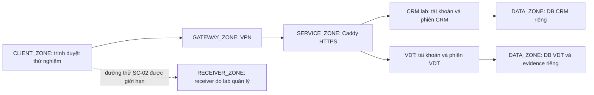

# VN Digital Trust — Phương án lab CRM local v0.1

**Ngày:** 2026-10-23 (Asia/Bangkok). **Trạng thái:** `PROPOSED`; chuẩn bị theo yêu cầu “Chưa có; chuẩn bị phương án lab local”. Đây là kế hoạch dựng môi trường và thu thập bằng chứng. Chưa triển khai CRM, VPN, TLS hoặc receiver theo kế hoạch này; chưa chạy TC-01:T01–T24, FLOW-01–10 hay VALID-G-01.

Phạm vi giữ nguyên một ABC Trading giả lập, hai chi nhánh BR-HCM/BR-DN, control AC-DEMO-01 trên AST-CRM và hai scenario SC-01/SC-02. Căn cứ: [phạm vi lab](../planning/lab-scope-and-fixtures-v0.1.md), [fixture](../planning/lab-fixtures-v0.1.json), [CE-01](../planning/control-evidence-v0.1.md), [TC-01](../planning/control-test-cases-v0.1.md), [cấu hình](../design/configuration-v0.1.md), [mẫu cấu hình](../design/config-template-v0.1.json), [lựa chọn công nghệ](../design/technology-decisions-v0.1.md) và [giao dịch storage](../design/storage-transactions-v0.1.md). Kế hoạch bổ sung này không sửa baseline hoặc tạo phê duyệt cấu hình.

## 1. Điểm xuất phát và phần sẽ dựng

| Thành phần | Bằng chứng hiện có / trạng thái | Phần cần làm trước lab CRM |
| --- | --- | --- |
| Nền PostgreSQL của VDT | [Báo cáo kiểm tra DB](database-checks-v0.1.json) ngày 2026-10-23 có phạm vi `POSTGRESQL_17_FOUNDATION_ONLY`, ghi 15 kiểm tra đạt, 0 lỗi. Báo cáo giữ CRM/FLOW/TC/VALID-G là `NOT_RUN`. | Hoàn thiện kiểm chứng ứng dụng, quyền trên request, giao dịch, đồng thời và khôi phục theo phạm vi từng gate. Kết quả DB không chứng minh CRM đã tồn tại. |
| Backend VDT | Đã có mã nền Django, migration, cấu hình/preflight, mô-đun risk và storage/scanner trong bước 06. Mã nguồn và kiểm thử riêng lẻ có phạm vi riêng. | Kiểm chứng luồng tích hợp trước công bố bằng chứng qua VDT; ghi báo cáo có phiên bản cho từng lần chạy. |
| CRM lab | Chưa có sản phẩm/build CRM hoặc môi trường được nghiệm thu. `AUTH-CRM-01.implementation_status` vẫn `NOT_IMPLEMENTED`. | Chuẩn bị một ứng dụng CRM lab riêng với dữ liệu giả lập và các chức năng tối thiểu bên dưới; chốt source/build và thư viện xác minh WebAuthn trước triển khai. |
| VPN, phân vùng mạng, DNS/TLS trình duyệt | Thiết kế đã có; chưa có kết quả lab local xác minh đường mạng và trust của máy khách. | Dựng mạng cô lập, gateway, luật truy cập, hostname ổn định, chứng chỉ và kiểm tra từ máy khách. |
| Scanner vận hành | Có interface/client fail closed trong mã VDT; chưa chứng minh daemon ClamAV/signature/socket hoạt động trong lab Linux. | Khóa patch/signature, cấu hình socket local và giới hạn, kiểm chứng mất kết nối/timeout/signature cũ trước nhận file evidence. |
| Receiver SC-02 | Chưa dựng, chưa chốt địa chỉ/đường truyền/chính sách đích. | Dựng điểm nhận nội bộ, có log và hạn mức, chỉ bật trong phiên thử được xác định. T24 tiếp tục `NOT_READY`/`NOT_RUN`. |

Phương án CRM tối thiểu chỉ phục vụ kiểm chứng phạm vi đồ án: đăng nhập hai bước, đăng ký/thu hồi/khôi phục credential, trạng thái tài khoản, đọc sáu khách hàng giả lập theo scope, yêu cầu export và audit. Build này cần được nhận diện là **CRM lab của dự án** trong mọi bằng chứng; kết quả của nó không đại diện cho sản phẩm CRM khác. Chưa chọn phần mềm VPN, sản phẩm CRM thương mại hoặc thư viện WebAuthn mới trong tài liệu này. Dòng công nghệ VDT đã chọn tiếp tục theo TECH-01–08; dependency lock của VDT không thay lock của CRM.

## 2. Bố trí local và danh tính độc lập

Host hiện tại có thể chạy các vùng bằng VM hoặc mạng ảo có luật lọc; mỗi vùng là một ranh giới cần kiểm chứng, không bắt buộc một VM riêng. Môi trường tham chiếu VDT là Debian 13, PostgreSQL 17, Django/DRF/Gunicorn, Caddy và ClamAV theo tài liệu thiết kế. Không mở dịch vụ thử ra Internet công cộng.

| Vùng / luồng | Cách chuẩn bị và điều phải kiểm chứng |
| --- | --- |
| CLIENT_ZONE → SERVICE_ZONE | Máy khách thử chỉ tới HTTPS của dịch vụ được cấp sau VPN. Kiểm trước/sau VPN bằng kết quả kết nối đối chiếu route và log gateway/firewall; timeout đơn lẻ không đủ. Nếu host cũng có cổng quản trị, tách đường quản trị đó khỏi máy khách dùng để lấy bằng chứng. |
| Consultant → VDT | Chỉ cấp đường VPN tới VDT và scope ASM-DEMO-01. Không tự cấp đường CRM, DB, evidence thô hoặc receiver. |
| Proxy → ứng dụng | App nghe loopback/socket hoặc interface riêng chỉ proxy truy cập. Chặn truy cập trực tiếp cổng app từ máy khách; xác nhận allowed hosts và nguồn trusted proxy. |
| SERVICE_ZONE → DATA_ZONE | DB CRM và DB VDT dùng danh tính/quyền riêng; port DB không có đường cho client/VPN user. Evidence root nằm ngoài web/static root; proxy không phát file trực tiếp. |
| SC-02 → RECEIVER_ZONE | Receiver thuộc hạ tầng lab, nằm ngoài tập đích được chính sách CRM cho phép nhận dữ liệu. Giới hạn đúng nguồn/đích/port/phương thức/thời gian/bytes của ca thử; không có relay hoặc forwarding ra ngoài lab. Đường phát từ client hay CRM server phải được chọn và ghi trước T24. |
| Cập nhật phần mềm/signature | Chuẩn bị gói và signature có nguồn/hashes trong giai đoạn dựng; nếu cần đường cập nhật tạm, ghi rõ nguồn đích và đóng trước lượt thử cô lập. Không mở egress tổng quát để làm T24. |

VDT giữ tài khoản U001–U004, chính sách local password và session của VDT. CRM dùng U101–U108 và cơ chế password + WebAuthn riêng. Mỗi ứng dụng có origin, cookie namespace, secret, DB role, credential và audit riêng; không dùng cookie/session VDT để đăng nhập CRM. Mật khẩu tạo trong quá trình provisioning riêng, không lấy từ username hoặc ghi vào fixture/repository/evidence. Người vận hành có thể là cùng một người nhưng vẫn dùng tài khoản và audit theo từng trách nhiệm; reviewer/approver cần đáp ứng tính độc lập của quyết định tương ứng.

Tên `trust.abc.test` và `crm.abc.test` là gợi ý đã có trong hồ sơ, chưa phải cấu hình hiệu lực. Trước dùng phải chốt phân giải tên local, certificate SAN/trust, origin HTTPS chính xác và RP ID hợp lệ. RP ID không chứa scheme/port/path; không tự dùng wildcard hoặc IP thay thế. Không dùng bỏ qua cảnh báo chứng chỉ làm bằng chứng đạt TLS. Authenticator/trình duyệt/OS cần có build được ghi nhận; hộp thoại PIN hoặc sinh trắc học không tự chứng minh khóa được bảo vệ bằng phần cứng.

Ngân sách VDT 2 vCPU/6 GiB RAM/60 GiB disk chỉ là ước lượng thiết kế. CRM, VPN, receiver và công cụ quan sát cần ngân sách riêng. Đo RAM/CPU/đĩa trước chạy tích hợp; có thể chuẩn bị từng phần tuần tự trên máy ít RAM, nhưng một ca end-to-end chỉ hợp lệ khi đủ các thành phần cần thiết đang chạy và cùng được quan sát.

## 3. Các giai đoạn dựng và điều kiện chuyển tiếp

| Giai đoạn | Công việc cụ thể | Đầu ra cần lưu | Điều kiện chuyển tiếp |
| --- | --- | --- | --- |
| L0 — chốt phạm vi | Ghi owner/operator/reviewer; phạm vi host, mạng ảo, tài khoản, endpoints, receiver, protocol và giới hạn thử. Chọn build CRM lab và thiết bị/trình duyệt dự kiến. | Scope có revision; danh mục thành phần; danh sách trường còn thiếu. | Owner xác nhận phạm vi; chưa có trường hiệu lực thì giữ `TO_SET_BEFORE_LAB`. Yêu cầu chuẩn bị phương án chưa tạo approval cho từng giá trị. |
| L1 — dựng nền cô lập | Tạo môi trường Linux local, phân vùng mạng, quyền hệ điều hành/DB riêng, đồng bộ thời gian; khóa gói theo build. Chuẩn bị khôi phục dữ liệu giả lập. | Manifest OS/app/DB/dependencies; topology/luật mạng; mô tả backup/reset. | Có đường quản trị được xác định, không có dữ liệu thật, dữ liệu/secret không nằm trong webroot. |
| L2 — VPN và HTTPS | Cấu hình gateway, đường vào dịch vụ, hostname và Caddy; thiết lập trust trên đúng máy khách. Kiểm trước/sau VPN, chống đi thẳng cổng app và cô lập DB. | Log kết nối và luật mạng; snapshot TLS/proxy không chứa khóa riêng; danh sách origin/RP ID dự kiến. | Máy khách tin cậy HTTPS; các đường được phép/không phép có observation và log đối chiếu. Chưa đạt thì SC-01 chưa sẵn sàng. |
| L3 — CRM và fixture | Dựng CRM lab độc lập; nạp bản sao có version của U101–U108 và CUS-001..006. Triển khai verifier WebAuthn phía server và policy bootstrap/recovery/revoke/export. | Source/build lock CRM; cấu hình resolved; manifest dữ liệu; danh mục đường login/API/enrollment/recovery. | Đủ chức năng quan sát T01–T23, origin/RP ID đúng; chưa đánh dấu control đạt chỉ vì form hoặc prompt hoạt động. |
| L4 — duyệt profile và quan sát | Điền đầy đủ AUTH-CRM-01, policy refs, TTL/thử lại/phiên/thu hồi/thông báo; snapshot hash. Thiết lập request/test/run IDs, log, đồng hồ và redaction. | Profile version được duyệt; preflight report; mẫu manifest evidence; danh sách test được mở chạy. | C01/C07/C08 có đầu vào phù hợp; mọi giá trị cần thiết và người duyệt được ghi. Không tự gán `APPROVED`. |
| L5 — kiểm thử CRM SC-01 | Chạy T01 trước để chứng minh control dương và đường quan sát hoạt động, rồi nhóm ca âm/enrollment/recovery/lifecycle/scope theo TC-01. Mỗi ca thay trạng thái dùng bản sao fixture. | Run record riêng cho từng test, log nguồn, observation và evidence đã biên tập. | Chỉ kết luận theo observed result/log; ca không chạy hoặc thiếu tiền điều kiện giữ trạng thái tương ứng. |
| L6 — chuẩn bị và thử SC-02 | Chốt chính sách export/đích và đường chuyển; dựng receiver; kiểm tra receiver bằng marker vô hại riêng; thiết lập phiên đọc U102; chỉ khi đủ gate mới thực hiện T24. | Policy/config version; log nguồn/mạng/receiver đồng bộ; hash/bytes/record IDs đối chiếu. | Bằng chứng phân biệt nguồn có thực hiện, đường có đi và receiver có nhận; lỗi môi trường không biến thành kết quả chặn. |
| L7 — đưa evidence vào VDT | Kiểm chứng scanner thật, private storage, authorization, file limits và rollback; nộp evidence qua gate, sau đó thực hiện xác minh nghiệp vụ độc lập. | EvidenceRevision IDs, scan metadata, quyết định verification, criteria/scope/version liên quan. | File chỉ COMMITTED sau quy trình kỹ thuật đầy đủ; CLEAN không tạo VERIFIED. Khi VDT intake chưa đạt, giữ artifact thu thập riêng ở thư mục hạn quyền và ghi `COLLECTED_NOT_INGESTED`. |
| L8 — assessment/retest và kết thúc lượt | Reviewer đối chiếu CE-01 và scope, lập assessment khi đủ đầu vào; reset credential/session/receiver sau lượt; retest dùng run/config/evidence mới. | Báo cáo test, hạn chế quan sát, quyết định review, manifest trước/sau và danh sách cleanup. | Kết luận truy ngược được tới revision cụ thể; mọi FLOW/VALID-G có report riêng trước thay đổi trạng thái. Không suy ra hiệu lực control từ checklist dựng lab. |

L7 có thể chuẩn bị song song với L1–L4, nhưng bằng chứng thu được chỉ vào trạng thái sử dụng nghiệp vụ sau gate intake và verification. Thiết kế lab không yêu cầu phải tạo SME approval, risk acceptance hay đóng treatment để hoàn thành thao tác dựng môi trường.

## 4. Hồ sơ cấu hình trước khi chạy

| Nhóm | Giá trị / trạng thái ở kế hoạch này | Cần chốt và lưu |
| --- | --- | --- |
| Hai yếu tố CRM | `PASSWORD + WEBAUTHN`, UV required, không TOTP fallback, không passwordless; baseline đã chốt. | Danh mục mọi đường đăng nhập thuộc scope; verifier kiểm UV/challenge/origin/RP ID/signature; pending-auth chưa có quyền nghiệp vụ. |
| Challenge TTL | **Đề xuất 120 giây; chưa được duyệt, chưa có hiệu lực.** | TTL theo build/môi trường, ràng buộc challenge với user/session/purpose, hết hạn tại mốc bằng TTL, tiêu thụ một lần. |
| Ngưỡng thử lại | **Đề xuất 5 lần; chưa được duyệt, chưa có hiệu lực.** | Cửa sổ đếm, khóa/tạm khóa, reset, đếm đồng thời và phân biệt password/second factor/recovery. |
| Idle timeout CRM | **Đề xuất 900 giây; chưa được duyệt, chưa có hiệu lực.** | Hoạt động kéo dài idle, loại trừ polling nền; absolute timeout, reauth và giới hạn trễ thu hồi. |
| Hostname/WebAuthn | `TO_SET_BEFORE_LAB`. | Product/build CRM, origin HTTPS allowlist, RP ID, cookie namespace, login routes, browser/OS/authenticator và trust evidence. |
| Bootstrap/thêm khóa/recovery | `TO_SET_BEFORE_LAB`. | Xác minh danh tính, actor có quyền duyệt, bước độc lập với password-only, revoke khóa cũ và hành động với phiên cũ. |
| Thông báo | `TO_SET_BEFORE_LAB`. | Đích nhận nội bộ đã duyệt, loại sự kiện, thời hạn; không gửi thư thật tới địa chỉ fixture `.example`. |
| SC-02 | `TO_SET_BEFORE_LAB`; T24 `NOT_READY`. | Receiver URL, địa chỉ/port nguồn đích, protocol, export policy, allowed destinations, owner, hạn mức và thời điểm bật/tắt. |
| VDT | Các trường môi trường và xác thực bắt buộc vẫn phải có cấu hình VDT được duyệt riêng. | Không dùng 120/5/900 làm mặc định của VDT. Giới hạn upload/scan đã có thiết kế không chứng minh scanner/TLS đã chạy. |

Ba số 120/5/900 chỉ nằm trong phần đề xuất/ví dụ cho tới khi được duyệt và materialize thành profile revision mới. Không sửa trực tiếp `effective_values` hoặc `readiness` của template thành giá trị hiệu lực để vượt preflight. Dùng thời gian server thực có đồng bộ; đồng hồ fixture 2026-10-09 là dữ liệu thiết kế, không ghi đè thời gian runtime. Ca hết hạn dùng fixture biến thể có thời điểm rõ ràng và giữ snapshot gốc.

## 5. Quy trình chạy hai scenario

### SC-01 — mật khẩu bị lộ, đăng nhập mới CRM

1. Ghi bằng chứng máy khách đã đến CRM qua VPN và HTTPS đúng origin; bắt đầu từ trạng thái chưa có phiên CRM được xác thực. Tách ca dương T01 khỏi các ca chỉ có password bằng session/browser context mới hoặc quy trình logout được xác nhận.
2. Với U102, dùng mật khẩu thử nghiệm đã cấp trong lab, không có assertion/credential bổ sung trong ca password-only. Kiểm cả hành vi giao diện và CRM/API đọc CUS-001 trước khi hoàn tất WebAuthn.
3. Thực hiện TC-01 đúng tiền điều kiện từng ca: password sai, credential sai user, challenge hết hạn/replay, origin/RP ID sai, thiếu UV, hủy prompt; tiếp tục bootstrap/thêm credential/recovery/revoke theo policy được duyệt.
4. Đối chiếu log server với test/request IDs và trạng thái phiên/quyền thực tế. Mở được trang đăng nhập, xuất hiện prompt hoặc bị timeout không đủ để kết luận control đạt.
5. Ghi riêng T19–T22 cho vòng đời tài khoản và scope CRM. SC-01 chỉ đánh giá lớp xác thực CRM sau tiền điều kiện VPN; không kết luận khả năng vượt VPN, phiên bị đánh cắp hay quyền admin.

Nếu dùng authenticator ảo trong kiểm thử lập trình, nhãn evidence phải nêu rõ đó là mô phỏng verifier. Bằng chứng tương thích trình duyệt/OS/authenticator và thao tác UV của người dùng cần lượt chạy với tổ hợp thực được nhận diện; không suy ra phần cứng bảo vệ khóa từ test ảo.

### SC-02 — chuyển dữ liệu từ phiên đọc đã có

1. Xác nhận U102 có phiên CRM hợp lệ và quyền đọc đúng CUS-001..003; SC-02 bắt đầu từ tiền điều kiện này, không phải kết quả giả định của SC-01. U102 vẫn bị giới hạn bản ghi/chi nhánh; thêm quyền export chỉ được thực hiện theo policy/biến thể có version.
2. Chốt trước hành vi cần quan sát: yêu cầu export tại CRM và/hoặc chuyển dữ liệu đã đọc từ client tới receiver. Ghi nguồn phát, endpoint, phương thức, định dạng, giới hạn tối đa ba bản ghi, marker của run và đường mạng. Không trộn hai cơ chế thành một kết luận chung.
3. Kiểm tra telemetry receiver bằng marker vô hại riêng trước lượt, ghi hash/bytes/thời điểm rồi reset trạng thái quan sát. Cách kiểm tra này chỉ chứng minh đường quan sát hoạt động trong cấu hình được ghi nhận; nó không là evidence T24 đã chạy.
4. Bật đúng đường thử được duyệt tới AST-RECEIVER trong RECEIVER_ZONE. Gửi duy nhất dữ liệu tổng hợp của ca thử, thu log nguồn, gateway và receiver; ghi cả trường hợp bị từ chối tại export, egress hoặc receiver. Giữ ngữ cảnh chính sách để phân biệt một đích thuộc lab với một đích được CRM cho phép nhận dữ liệu.
5. Đối chiếu record IDs, marker, SHA-256, số bytes và thời điểm hai đầu. Nếu thiếu log nguồn, receiver không hoạt động hoặc không chứng minh hành vi đã được thực hiện, kết quả là `INCONCLUSIVE`; không ghi PASS chỉ vì receiver không có dữ liệu.
6. Tắt đường thử và receiver theo scope sau lượt, vô hiệu phiên/credential tạm khi cần, giữ artifact và manifest đã biên tập. Kết luận EX-DEMO-01 chỉ theo chính sách và đường chuyển đã thử; MFA đăng nhập mới không tự làm giảm G của SC-02.

## 6. Ma trận thu thập bằng chứng

Các mã `LAB-*` dưới đây là nhãn artifact dự kiến để nhóm hồ sơ, chưa phải EvidenceRevision đã được tạo. Mỗi dòng khởi đầu `NOT_RUN`; dòng T24 còn có readiness `NOT_READY` tới khi đủ điều kiện.

| Nhóm / ca | Điều cần quan sát | Artifact tối thiểu | Điều kiện kết luận / giới hạn |
| --- | --- | --- | --- |
| LAB-ENV — C01/C07/C08, VPN precondition | Đường trước/sau VPN, TLS trust, origin/RP ID, build, thời gian và scope. | Topology và luật mạng; log connect/deny; snapshot config đã bỏ secret; ảnh browser trust; profile hash; danh sách login routes. | Có observation phù hợp và log giải thích; không dùng timeout đơn lẻ làm evidence deny. |
| LAB-AUTH-POS — T01, C02/C06 | Quyền nghiệp vụ trước/sau hai yếu tố và đọc CUS-001. | Trace đã biên tập; audit password-step/WebAuthn/session; ID bản ghi đọc; cấu hình verifier. | T01 chạy đúng user/credential/origin/UV; phiên nghiệp vụ chỉ xuất hiện sau hai yếu tố. |
| LAB-AUTH-NEG — T02–T11, C02/C03/C06 | Password-only, password sai, assertion sai user, expiry/replay, origin/RP ID/UV và hủy. | Run record từng ca; request IDs, lý do từ chối phía server, kiểm quyền CRM/API sau thử. | Mỗi ca kết luận riêng. Thiếu telemetry hoặc tiền điều kiện sai → INCONCLUSIVE. |
| LAB-ENROLL — T12–T14, C04 | Password-only không thêm khóa; bootstrap hợp lệ của U105 có phê duyệt. | Policy revision; hồ sơ phê duyệt giả lập; audit enrollment; test âm và login sau bootstrap. | Không dùng `ENROLLED_SIMULATED` thay bằng chứng credential được đăng ký thực. |
| LAB-RECOVERY — T15–T17, C05 | Thu hồi khóa cũ, recovery, khóa mới và phiên cũ. | Revoke/recovery policy; actor/approver; audit; kết quả khóa cũ/mới; kết quả xử lý phiên riêng. | Phiên hiện hữu không suy ra từ kết quả đăng nhập mới. |
| LAB-PATHS — T18, C01/C07 | Đường đăng nhập thay thế và cổng app không vượt boundary. | Danh mục endpoints đã duyệt; kết quả từng đường; origin/TLS/proxy/app logs. | Chỉ phủ phạm vi đã liệt kê; phát hiện đường mới cần cập nhật scope và kiểm lại. |
| LAB-LIFECYCLE — T19/T20, AC-DEMO-02 | PENDING/DISABLED/EXPIRED và thu hồi khi đang có phiên. | Snapshot trạng thái trước/sau; thời gian server; policy thu hồi; audit và request sau thu hồi. | Cần policy/độ trễ thu hồi đã chốt; không gộp vào kết quả MFA. |
| LAB-SCOPE — T21/T22, AC-DEMO-03 | U102 đọc HCM, bị chặn DN; admin không tự có quyền đọc/export toàn bộ. | Grant/scope snapshot; trace CUS-001/CUS-004; audit đọc/export. | So khớp role và scope đồng thời; riêng với auth thành công. |
| LAB-OBSERVABILITY — T23, C08 | CRM/log không khả dụng làm kết quả không xác định. | Mô tả lỗi có kiểm soát, health/log mất, trạng thái test. | Ghi INCONCLUSIVE và nguyên nhân; không ghi control đã chặn. |
| LAB-TRANSFER — T24, SC-02/EX-DEMO-01 | Phiên đọc có sẵn, export/egress và nhận dữ liệu theo đường đã duyệt. | Policy/receiver config; marker/hash/bytes/record IDs; log nguồn/mạng/receiver; thời gian bật/tắt. | Tách kết quả quyền export, egress và quan sát/phát hiện; chỉ kết luận khi hành vi thực sự chạy và được đối chiếu. |
| LAB-INTAKE — VDT storage/scanner | Bounded upload, scanner thật, trạng thái storage, gate đọc và sự cố trước final commit. | Release/config; scan engine/signature version; trace ingest/rollback; storage events/audit và digest. | Là kiểm chứng VDT riêng. COMMITTED/CLEAN không đồng nghĩa evidence VERIFIED hoặc CRM control SATISFIED. |

Mỗi run manifest cần có: `run_id`, `test_id`, criteria/control version, scenario, environment/build/profile IDs và hashes, scope, actor/reviewer, tài khoản giả lập, dữ liệu/credential label, tiền điều kiện, expected result, observed result, execution/readiness status, thời gian UTC có timezone, request IDs, artifact IDs/hashes, trạng thái redaction và hạn chế quan sát. Chỉ lưu nhãn credential cần truy vết; không lưu private key, password, session token, recovery code hoặc toàn bộ assertion. Ảnh không chứa bí mật; log chỉ thu trường cần chứng minh tiêu chí. Sao lưu manifest cùng artifact và quyền truy cập của chúng.

Dữ liệu khách hàng chỉ gồm CUS-001..006 với tên/email giả lập `.example` trong fixture; không nạp PII, CRM dump hoặc thông tin khách hàng thật. Bộ fixture sau provisioning có manifest riêng; mọi thay đổi test tạo biến thể/run mới. Nguồn tham chiếu bên ngoài chỉ là metadata, không yêu cầu VDT tự fetch URL.

## 7. Trạng thái bàn giao và điều kiện hoàn thành

| Hạng mục | Trạng thái sau khi soạn kế hoạch |
| --- | --- |
| Phương án local và ma trận evidence | Đã chuẩn bị tài liệu đề xuất; chờ triển khai theo các gate. |
| Cấu hình CRM có hiệu lực / approval | `TO_SET_BEFORE_LAB`; chưa có approval mới từ tài liệu này. |
| CRM/VPN/TLS/receiver/scanner vận hành theo phương án | `NOT_IMPLEMENTED_OR_VERIFIED`. |
| TC-01:T01–T23 | `NOT_RUN`; readiness phụ thuộc L0–L4 và tiền điều kiện riêng của ca. |
| TC-01:T24 | `NOT_RUN`; `NOT_READY` tới khi chốt và kiểm chứng SC-02. |
| FLOW-01–10; VALID-G-01 | `NOT_RUN`; cần báo cáo thực thi riêng. |
| Assessment hiệu lực control CRM | Chưa tạo từ kế hoạch. Thiếu evidence không được chuyển thành control failure hoặc SATISFIED. |

Lab chỉ được ghi hoàn thành theo phạm vi đã chạy khi có môi trường/config được nhận diện, tiền điều kiện được chứng minh, đủ run records và artifact đối chiếu, reviewer kết luận đúng CE-01 và mọi ca chưa chạy/không xác định được ghi rõ. Rủi ro, risk acceptance, calibration và closure cần các đầu vào/quyết định nghiệp vụ tương ứng; tài liệu dựng lab không tạo các kết quả đó.
